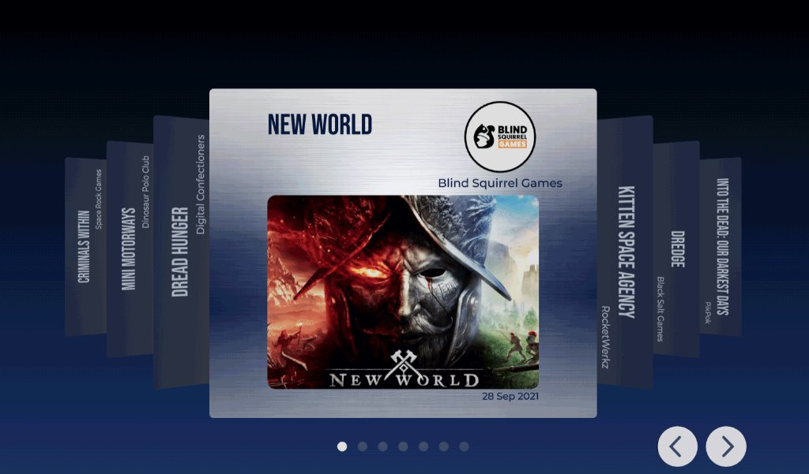

# 3D Card Carousel

An interactive 3D card carousel built with **React**, **Vite**, **Three.js** (`@react-three/fiber` & `@react-three/drei`), and **`@react-spring/three`**. Cards are arranged along a curved 3D arc with spring-driven transitions, brushed-metal PBR materials, and JSON-driven content.



## Features

- **Curved 3D Carousel & Shortest-Path Navigation**: Cards animate smoothly along an arc using `@react-spring/three` and always take the shortest wrap-around path when jumping between slides.
- **Physically Based Card Materials**: Extruded rounded-rectangle cards use `meshPhysicalMaterial` with brushed-iron PBR texture maps (base color, normal, roughness, metallic) and an animated `GradientTexture`.
- **State-Aware Card Layout**:
  - **Center card**: Displays the full game/project artwork, title, studio/company name, note, and a clickable circular studio logo with hover glow that opens the studio's website in a new tab.
  - **Side cards**: Automatically reorient their typography vertically along the outer edges and dim their surface gradients.
- **Multiple Navigation Controls**: Click any visible card directly, use the 3D left/right arrow buttons, or click any dot in the 3D pagination indicator.
- **Autoplay with Hover & Interaction Pause**: Automatically advances slides every 6.5 seconds, pauses while the pointer is over the canvas, and briefly pauses after manual clicks.
- **Responsive & Embed-Friendly**: Adapts canvas aspect ratio for desktop (`2.75`) and mobile (`0.85`, viewport width `< 768px`) and posts `{ type: 'iframe-resize', height }` messages to `window.parent` when embedded in an `<iframe>`.

## Tech Stack

- [React 19](https://react.dev/)
- [Vite 7](https://vite.dev/)
- [Three.js](https://threejs.org/)
- [@react-three/fiber](https://docs.pmnd.rs/react-three-fiber/)
- [@react-three/drei](https://github.com/pmndrs/drei)
- [@react-spring/three](https://www.react-spring.dev/)
- [ESLint 9](https://eslint.org/)

## Getting Started

### Prerequisites

- [Node.js](https://nodejs.org/) (LTS recommended) and npm

### Installation & Development

```bash
# Install dependencies
npm install

# Start the development server with HMR
npm run dev
```

### Other Scripts

```bash
# Build for production (outputs to dist/)
npm run build

# Preview the production build locally
npm run preview

# Run ESLint across the project
npm run lint
```

## Customizing Carousel Data

Carousel items are fetched at runtime from [`public/api-data/datas.json`](public/api-data/datas.json). Each entry follows this schema:

```json
[
  {
    "id": 0,
    "logo": "/api-data/images/BlindSqurrelGames/logo.jpg",
    "image": "/api-data/images/BlindSqurrelGames/image.jpg",
    "title": "New World",
    "company": "Blind Squirrel Games",
    "note": "28 Sep 2021",
    "website": "https://blindsquirrelentertainment.com/"
  }
]
```

| Field     | Description                                                        |
| --------- | ------------------------------------------------------------------ |
| `id`      | Zero-based sequential index used by the carousel and dot controls. |
| `logo`    | Path to the circular studio/brand logo image.                      |
| `image`   | Path to the featured artwork displayed on the active card.         |
| `title`   | Primary card heading (also shown on the edge of side cards).       |
| `company` | Optional studio or company label.                                  |
| `note`    | Release date or short description shown at the bottom of the card. |
| `website` | URL opened in a new tab when clicking the active card's logo.      |

Place custom images inside `public/api-data/images/` (or update the paths accordingly).

## Project Structure

```text
├── index.html
├── package.json
├── vite.config.js
├── public/
│   ├── api-data/
│   │   ├── datas.json              # Carousel slide data
│   │   ├── siteInfo.json           # Optional site title metadata
│   │   └── images/                 # Card artwork and studio logos
│   ├── BtnImages/                  # Arrow button textures
│   ├── CardTextures/               # Brushed-iron texture maps
│   └── Fonts/                      # Font assets
└── src/
    ├── App.jsx                     # Canvas setup, data fetching, responsive resize & iframe messaging
    ├── main.jsx                    # React entry point
    ├── assets/                     # Bundled fonts, icons, button textures, and card PBR maps
    └── components/
        ├── CarouselContainer.jsx   # Autoplay timer and coordination of carousel, dots, and arrows
        ├── CardCarousel.jsx        # 3D arc positioning, shortest-path wrapping, and spring animation
        ├── Card.jsx                # Individual card composition
        ├── CardBoard.jsx           # Extruded rounded card mesh with brushed-metal PBR material
        ├── AnimatedCardBoard.jsx   # Gradient and surface transitions between center and side states
        ├── AnimatedCardTitleText.jsx
        ├── AnimatedCardCompanyText.jsx
        ├── AnimatedCardDateText.jsx
        ├── AnimatedSubCardImage.jsx
        ├── LogoImageWithOutline.jsx # Clickable circular logo with hover highlight
        ├── DotCarousel.jsx         # 3D dot pagination controls
        ├── SliderArrows.jsx        # 3D previous/next arrow controls
        └── ...                     # Geometry/UV utilities and custom hooks
```

## License

The source code in this project is licensed under the [MIT License](LICENSE).

> **Note on third-party assets:** Game artwork, studio logos (`public/api-data/images/`), PBR textures, and font files included for demonstration purposes remain the property of their respective owners and are governed by their original licenses.

